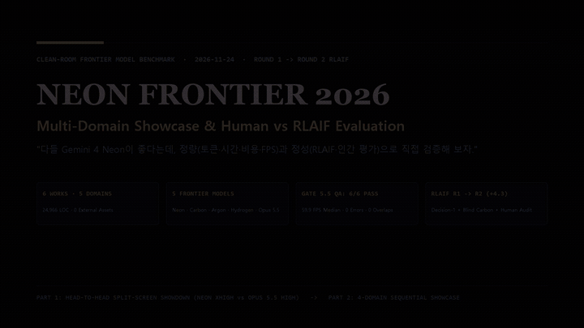

# Neon Frontier 2026 — Multi-Domain Clean-Room Model Benchmark & RLAIF

[](./LICENSE)
[-4fb3a2.svg)](#4-round-1--round-2--최종-인간-정성-평가-결과)
[-6aa1e0.svg)](#4-round-1--round-2--최종-인간-정성-평가-결과)
[](#7-참고-문헌-verified-references)

---

## 1. 이 프로젝트를 만든 이유 (Motivation)

2026년 11월 18일 **Google Gemini 4 Neon** 출시 직후 SNS(X), YouTube, Reddit 커뮤니티 곳곳에서 *"Neon이 정말 압도적으로 좋다"*, *"Opus 5.5와 비등하면서 더 빠르고 싸다"*는 반응과 *"디자인 미감은 여전히 AI스럽다"*, *"xHigh가 토큰을 과하게 태운다"*는 반론이 동시에 쏟아졌습니다.

**단순한 벤더 벤치마크 표나 남의 후기만 믿기보다, 실제로 공개된 바이럴 리퍼런스(영상·댓글·커뮤니티 답글까지 포함)를 전부 조사한 뒤 아트·정밀 기계 CAD·3D 건축/컴퓨팅·항공우주 열역학·실시간 천 물리 등 5대 도메인에 걸쳐 직접 클린룸(Zero-Asset)으로 만들어 보고, 정량 지표(실측 토큰·캐시 적중률·시간·비용·쿼터·FPS)와 정성 지표(멀티모달 RLAIF + 최종 인간 직접 평가)로 Gemini 4 Neon이 정말 어떻게, 어디까지 좋은지 확인**하기 위해 이 프로젝트를 진행했습니다.

---

## 2. 한 화면 데모 비교 영상 (Head-to-Head Showdown → 4대 도메인 순차 쇼케이스)

먼저 **동일 클린룸 스펙 정면 대결**(`Chronos Calibre N-4 · Gemini 4 Neon XHigh` vs `Chronos Calibre O-5 · Claude Opus 5.5 High`)을 좌우 분할 한 화면에 동시에 비교한 뒤, 나머지 4개 도메인 작품(`Cambridge Study 1936 + UTM` → `AeroFan X-900 Turbofan CAD` → `ChromaForge Hex-Flame & 57.6K Formula Relight` → `Kinetic Atelier Rube Goldberg + XPBD Cloth`)과 최종 Human vs RLAIF 스코어보드를 순차적으로 보여줍니다.



- **고화질 풀버전 영상 (`1920×1080 @ 24 fps`, H.264 MP4):** [media/demo_comparison.mp4](./media/demo_comparison.mp4) · [GitHub Release v1.0.0 직접 재생/다운로드](https://github.com/hobby-programmer-5000/neon-frontier-bench-2026/releases/download/v1.0.0/demo_comparison.mp4)
- **정면 대결 스틸 포스터:** [media/demo_poster.png](./media/demo_poster.png)

> 모든 6개 작품은 **외부 3D 모델·텍스처 이미지·오디오·CDN 링크 `0`개**로, 100% 절차적 코드(`24,966 LOC`)만으로 로컬 Three.js + WebGL2 + SVG + Web Audio API에서 실시간 구동됩니다.

---

## 3. 역할 분담 및 기여 내역 (Human vs AI Contribution Split)

이 프로젝트는 **인간 벤치마크 설계·검증자(`hobby-programmer-5000`)**와 **AI 에이전트 오케스트레이터(`antigravity`)**의 역할과 책임을 명확히 분리하여 공동 제작했습니다 ([CONTRIBUTORS.md](./CONTRIBUTORS.md) 참고).

| 주체 | 계정 / 식별자 | 핵심 역할 및 기여 내역 |
|---|---|---|
| **Human Author** | `hobby-programmer-5000` (`hobbyprogrammer5000@gmail.com`) | • **프로젝트 기획·문제 제기:** *"다들 Neon이 좋다니 정량·정성으로 직접 검증하자"*는 실험 목표 설정<br>• **벤치마크 요구사항 설계:** SNS·유튜브 영상 및 댓글/답글 전수 조사 지시, 아트·설계 등 다중 도메인 구현, 토큰·시간·모델·Effort·기법·실제 성능 계측 및 정량+정성 RLAIF 요구<br>• **공정성 거버넌스 결정:** Claude 5시간/주간 쿼터 소진 확인 후 *"공정성을 위해서는 어느 트랙도 추가로 다듬지 않는다"*는 원칙으로 **Round 2 최종 동결(Freeze)** 확정<br>• **최종 인간 정성 평가(Ground Truth):** 6개 라이브 작품 및 블라인드 시계 대결을 직접 조작·평가해 **RLAIF 심판의 미감 편향(Judge Blind-Spot)**을 실증<br>• **공개 저장소·데모 영상 디렉팅:** 정면 대결 → 순차 전시 단일 화면 구성, MIT 라이선스 및 공동 기여 표기 지시 |
| **AI Engineering Partner** | `antigravity` (`Gemini 4 Neon XHigh` 코디네이터 + 멀티모델 Swarm) | • **리서치 및 팩트체크:** 15+ 공식/커뮤니티 리퍼런스·유튜브 댓글·레딧 스레드 브라우저 실사, `7/7` Crossref DOI 학술 검증<br>• **클린룸 멀티모델 Swarm 구축:** 5개 모델(`Neon`, `Carbon`, `Argon`, `Hydrogen`, `Opus 5.5`) × 5개 기법으로 6개 작품(`24,966 LOC`) 및 인터랙티브 전시 포털 구현<br>• **정량·정성 자동화 파이프라인:** `transcript.jsonl` 실측 토큰/캐시 추출기, 7-Cell Effort API 스윕(`low→xhigh`, 32K vs 64K 캡 실험), Gate 5.5 Playwright Chrome WebGL2 QA 하네스, 이중 RLAIF(`gemini-decision-1` + 블라인드 `gemini-4-carbon`) 엔진 및 데모 비교 영상 합성 자동화 |

---

## 4. Round 1 → Round 2 → 최종 인간 정성 평가 결과

모든 트랙은 **동일한 `Round 1 (초기 구현 + QA + 블라인드 RLAIF) → Round 2 (AI 비평 피드백 반영 자가개선 + 무경합 QA + RLAIF)` 2라운드 규칙**으로 완주한 뒤 비교 공정성을 위해 동결했습니다.

### A. 전체 트랙 정량(토큰·캐시·비용·성능) & 정성(R1 → R2 RLAIF vs Human) 총괄표

> 모든 토큰·캐시 적중률은 추정치가 아닌 각 워커의 `.system_generated/logs/transcript.jsonl` 실측값입니다. 비용은 공식 Nov 2026 Gemini API Paid Tier 단가(`Neon $3/$15`, `Carbon·Argon $2/$10`, `Hydrogen $1.5/$7.5`) 및 Claude Opus 5.5 기준 단가(`$5/$25`)로 산출했습니다. RLAIF 복합점수 = `0.60 × gemini-decision-1 (6축 확률 루브릭)` + `0.40 × Blind gemini-4-carbon (블라인드 정성 비평)`.

| 인간 순위 | 트랙 / 작품 | 도메인 | 모델 & Effort | 적용 기법 | 누적 입력 토큰 (캐시%) | 누적 출력 토큰 | API 환산 | 최종 LOC | R1 QA → R2 QA (FPS/에러) | R1 RLAIF | R2 RLAIF (`Δ`) | **Human 점수** |
|:---:|---|---|---|---|---:|---:|---:|---:|---|---:|---:|---:|
| **#1** | **Chronos Calibre O-5** (`track-1b`) | 호롤로지 · 정밀 CAD (정면 대결) | `claude-opus-5-5` (`high`) | Cross-Vendor Single-Agent | 25,952,527 (`95.5%`) | 217,391 | **\$23.61** *(5h 쿼터 100%)* | 2,466 | `59.9 / 0` → `59.9 / 0` | 76.1 | 81.2 (`+5.1`) | **88.8** |
| **#2** | **Chronos Calibre N-4** (`track-1a`) | 호롤로지 · 정밀 CAD (정면 대결) | `gemini-4-neon` (`xhigh`) | Clean-Room Specialist | 12,859,283 (`92.6%`) | 204,568 | **\$7.69** *(3.07× 저렴)* | 4,941 | `29.9 / 0` → `59.9 / 0` | 75.2 | **81.4 (`+6.2`)** | **80.0** |
| **#3** | **Cambridge Study 1936** (`track-2`) | 3D 건축 · 보편 튜링 머신 | `gemini-4-neon` (`xhigh`) ×2 | 2-Worker Specialist Swarm | 18,988,736 (`78.1%`) | 266,872 | \$18.71 | 5,811 | `30.0 / 0` → `59.9 / 0` | 73.8 | 79.2 (`+5.4`) | **78.8** |
| **#3** | **Kinetic Atelier** (`track-5`) | 120Hz 루브 골드버그 · XPBD 천 | `neon (high)` → `hydrogen (xhigh)` | Orchestrator → Executor | 13,107,559 (**`96.4%`**) | 205,276 | **\$3.70** *(최고 멀티에이전트 ROI)* | 4,148 | `59.5 / 0` → `59.9 / 0` | 74.4 | 75.5 (`+1.1`) | **78.8** |
| **#5** | **AeroFan X-900** (`track-3`) | 항공우주 CAD · 브레이튼 열역학 | `gemini-4-carbon` (`high`) | One-Shot Master Spec | 6,816,192 (`71.5%`) | 152,803 | \$5.90 | 4,597 | `59.9 / 0` → `59.9 / 0` | **81.7** *(R1 1위)* | 80.5 (`-1.2`) | **77.5** |
| **#6** | **ChromaForge** (`track-4`) | GPU 셰이더 아트 · 57.6K 수식 CV | `gemini-4-argon` (`high`) | Iterative Refinement | 2,374,818 (`81.5%`) | 79,172 | **\$1.87** *(최저 비용)* | 3,003 | `FAIL (47.3s)` → `PASS (59.9 / 0)` | 71.1 | 80.2 (**`+9.1`**) | **75.0** |

### B. Round별 핵심 변화 요약

- **Round 1 (베이스라인 구축 & 초기 QA/RLAIF — 평균 `75.4`):**
  - `Gemini 4 Carbon (High)` One-Shot (`AeroFan X-900`)이 **첫 시도만에 `81.7점` (2위 대비 `+5.6점`, 고정 `59.9 FPS`)**으로 압도적 1차 수렴력을 증명했습니다.
  - 정면 대결 1라운드에서는 `Claude Opus 5.5` (`76.1`)가 `Gemini 4 Neon` (`75.2`)을 근소하게 앞섰고, `ChromaForge` (`Argon`)는 47.3초 셰이더 프리웜 지연으로 네비게이션 타임아웃(`FAIL`)이 포착되었습니다.
  - 블라인드 `Carbon` 비평가가 각 트랙의 실전 결함(Track 1A 매크로 헤더 충돌·29.9 FPS, Track 1B 분해도 지시선 이탈, Track 2 `Busy Beaver` UI 상태 비동기화·635 드로우콜, Track 3 단면 캡 해칭 부재, Track 4 47.3s 프리웜·화이트아웃·`"Noon 4"` 글리프, Track 5 배경 부유감·목재 스트레칭)을 정확히 짚어냈습니다.
- **Round 2 (블라인드 RLAIF 피드백 자가개선 — 평균 `79.7`, `+4.3점`, 6/6 PASS):**
  - **전 트랙 `59.9 FPS` 중앙값, `0` 콘솔/페이지/HTTP 에러, `0` HUD 오버랩 (`1440×900` & `700×900`)** 달성.
  - `ChromaForge`는 분석적 컬-노이즈 셰이더 교체로 프리웜을 **`47,282 ms → 1,832 ms` (25.8× 가속)**하고 ACES 필믹 톤매핑과 `"Neon 4"` 글리프를 교정해 **최대 `+9.1점` (`71.1 → 80.2`)** 상승했습니다.
  - `Cambridge Study 1936`은 `mergeGeometries` 최적화로 드로우콜을 **`635 → 142` (`-77.6%`)** 감축하고 `59.9 FPS`를 회복했으며, `Chronos Calibre N-4` (`Neon XHigh`)는 5-Plane GPU SVG 분리 및 3D Z-돌출 벽면 추가로 `29.9 → 59.9 FPS`, RLAIF **`81.4점` (AI 기준 1위)**을 달성했습니다.
  - **쿼터 실증:** 동일 2라운드 완주 과정에서 **`Claude Opus 5.5` 단일 워커가 5시간 쿼터 100%를 소진**한 반면, **Gemini 4 워커 7명 + 코디네이터**는 5개 작품 전체를 완주하고도 **Gemini 쿼터 29%를 잔여** 확보했습니다.
- **최종 Human Qualitative Evaluation vs RLAIF 정렬 감사 (핵심 발견!):**
  - **평균 오차는 초정밀(`Bias = -0.12`, `MAE = 3.49`)**했지만, **정면 대결 순위가 뒤집혔습니다:** 인간은 `Claude Opus 5.5` (**88.8**)에 `Neon XHigh` (**80.0**) 대비 **`+8.8점`**을 부여하며 YouTube 댓글(`@amok8938`: *"Opus의 절제된 미감 vs Gemini의 다소 AI스러운 느낌"*)을 실증했습니다. 단, 조작성에서는 `Neon`(*"조작은 하기 편한다"*)이 `Opus`(*"조작은 아쉽다"*)보다 명확히 우세했습니다.
  - **RLAIF 심판 편향(Judge Blind-Spot) 정량 발견 (`scipy.stats`):**
    - `Decision-1 Visual Craft` 축은 인간 미감과 **음(-)의 상관(`Spearman ρ = -0.261`, `r = -0.177`)**을 보였습니다 — AI 심판은 시각 밀도·화려함(`ChromaForge`, `AeroFan`, `Neon Watch`)을 과대평가하고 절제된 자연스러움(`Opus Watch`)을 과소평가했습니다.
    - 반대로 **`Anti-AI-Look` 축(`ρ = +0.696`, `r = +0.590`)**과 **블라인드 `Carbon` 비평가(`ρ = +0.582`, `r = +0.434`)**가 인간 취향 순위를 가장 정확히 예측했습니다.

---

## 5. 제어된 Model × Effort API 스윕 (`low → xhigh`) & 32K 과사고 절단 절벽

동일 단일 프롬프트(*스위스 이스케이프먼트 & 이중 진자 RK4 위상공간 스튜디오*)를 Gemini Interactions API(`v1`)로 직접 호출해 `thinking_level`별 사고 토큰(`thought_tokens`), 출력 토큰, 지연시간, 공식 USD 비용, Chrome QA, `gemini-decision-1` RLAIF 점수를 계측했습니다.

| Cell (`64K Cap`) | Model | Effort | Wall (s) | Thought Tok | Output Tok | Tok/s | 공식 USD | LOC | Chrome QA | `Decision-1` RLAIF | 점수/센트 |
|---|---|---|---:|---:|---:|---:|---:|---:|---|---:|---:|
| `neon_low` | `gemini-4-neon` | `low` | 185.98 | 1,947 | 14,368 | 87.7 | **\$0.2460** | 1,340 | PASS (`59.9`) | 87.70 | **3.6** |
| `neon_medium` | `gemini-4-neon` | `medium` | **185.46** | 6,340 | 17,765 | 130.0 | \$0.3628 | 1,650 | PASS (`59.9`) | **88.72** | **2.4** *(Pareto 최적)* |
| `neon_high` | `gemini-4-neon` | `high` | 398.13 | 17,465 | 28,510 | 115.5 | \$0.6909 | 2,502 | PASS (`59.9`) | 89.53 | 1.3 |
| `neon_xhigh` | `gemini-4-neon` | `xhigh` | 506.45 | 29,053 | 30,523 | 117.6 | \$0.8949 | 2,623 | PASS (`59.9`) | 89.83 | 1.0 |
| `hydrogen_xhigh` | `gemini-4-hydrogen` | `xhigh` | 315.45 | 41,301 | 24,235 | **207.8** | \$0.4921 | 2,062 | PASS (`59.9`) | 67.90 *(64K 포화)* | 1.4 |
| `argon_high` | `gemini-4-argon` | `high` | 284.66 | 6,237 | 21,113 | 96.1 | \$0.2743 | 1,901 | FAIL (`1 err`) | 41.25 *(0.5× 페널티)* | 1.5 |
| `carbon_high` | `gemini-4-carbon` | `high` | 784.28 | 36,311 | 27,690 | 81.6 | \$0.7072 | 2,362 | PASS (`59.9`) | **90.10** *(단일샷 1위)* | 1.3 |

> **32K Cap 과사고(Overthinking) 절단 절벽 발견 ([effort_sweep_32k_cap.json](./results/effort_sweep/effort_sweep_32k_cap.json)):**  
> `max_output_tokens = 32,768` 조건에서는 `neon_xhigh`(사고 `90.6%`, 352 LOC 절단), `hydrogen_xhigh`(사고 `98.3%`, 53 LOC 절단), `carbon_high`(사고 **`99.99%`**, 출력 **3토큰 / 1 LOC**)가 코드 생성 전 출력 한도를 소진했습니다. `high`/`xhigh` 운용 시 반드시 `max_output_tokens = 65536` 이상 설정이 필수이며, **`Neon Medium`이 Carbon High 품질의 `98.4%`를 `23.6%` 시간(`185s`)에 달성하는 최적 가성비 지점**이었습니다.

---

## 6. 로컬 실행 및 재현 가이드

```bash
# 1. 로컬 Three.js 및 Playwright 의존성 설치
npm install

# 2. 인터랙티브 전시 포털 실행 (http://127.0.0.1:4173/)
node scripts/serve_exhibition.mjs 4173

# 3. Gate 5.5 Chrome WebGL2 자동 QA 재실행
node qa/run_qa.mjs works 2

# 4. 멀티모달 RLAIF 재평가 (GEMINI_API_KEY 필요)
python scripts/run_rlaif_eval.py works 2
```

### 저장소 구조
- [`index.html`](./index.html), [`portal.js`](./portal.js), [`portal.css`](./portal.css) — 6개 작품 라이브 실행, 블라인드 시계 대결, Effort 차트, Human vs RLAIF 평가표 포털
- [`works/`](./works/) — 6개 클린룸 작품 소스 (`track-1a-watch-neon` ~ `track-5-kinetic-cloth`)
- [`docs/REFERENCE_ANALYSIS.md`](./docs/REFERENCE_ANALYSIS.md) — 15+ 공식/유튜브/레딧 리퍼런스 및 댓글 분석 Dossier
- [`docs/SPEC_CONTRACT.md`](./docs/SPEC_CONTRACT.md) — 클린룸 스펙, 6축 RLAIF 루브릭, 공식 단가 계약서
- [`docs/REFERENCES.md`](./docs/REFERENCES.md) — Crossref 검증 완료 학술 참고 문헌
- [`results/`](./results/) — `swarm_telemetry.json`, `qa_round1/2.json`, `rlaif_round1/2.json`, `human_vs_rlaif_final.json`, `effort_sweep/`
- [`media/`](./media/) — `demo_comparison.mp4`, `demo_preview.gif`, `demo_poster.png`

---

## 7. 참고 문헌 (Verified References)

### A. 학술 논문 및 공학 원전 (`7/7` Crossref DOI 라이브 검증 완료 — [docs/REFERENCES.md](./docs/REFERENCES.md))
1. **Litvin, F. L., & Fuentes, A. (2004).** *Gear Geometry and Applied Theory* (2nd ed.). Cambridge University Press. https://doi.org/10.1017/cbo9780511547126
2. **Schlick, C. (1994).** An Inexpensive BRDF Model for Physically-based Rendering. *Computer Graphics Forum*, 13(3), 233–246. https://doi.org/10.1111/1467-8659.1330233
3. **Turing, A. M. (1937).** On Computable Numbers, with an Application to the Entscheidungsproblem. *Proceedings of the London Mathematical Society*, s2-42(1), 230–265. https://doi.org/10.1112/plms/s2-42.1.230
4. **Mattingly, J. D. (2006).** *Elements of Propulsion: Gas Turbines and Rockets*. AIAA. https://doi.org/10.2514/4.861789
5. **Bridson, R., Houriham, J., & Nordenstam, M. (2007).** Curl-noise for procedural fluid flow. *ACM Transactions on Graphics (SIGGRAPH 2007)*, 26(3), Article 46. https://doi.org/10.1145/1276377.1276435
6. **Phong, B. T. (1975).** Illumination for computer generated pictures. *Communications of the ACM*, 18(6), 311–317. https://doi.org/10.1145/360825.360839
7. **Macklin, M., Müller, M., & Chentanez, N. (2016).** XPBD: Position-based simulation of compliant constrained dynamics. *Proceedings of MIG '16*, 49–54. https://doi.org/10.1145/2994258.2994272
8. **Bai, Y., et al. (2022).** Constitutional AI: Harmlessness from AI Feedback. *arXiv:2212.08073*. https://arxiv.org/abs/2212.08073
9. **Lee, H., et al. (2024).** RLAIF vs. RLHF: Scaling Reinforcement Learning from Human Feedback with AI Feedback. *ICML 2024 (PMLR 235)*. https://arxiv.org/abs/2309.00267

### B. 분석한 공개 쇼케이스·YouTube·커뮤니티 리퍼런스 ([docs/REFERENCE_ANALYSIS.md](./docs/REFERENCE_ANALYSIS.md))
- Google Blog — *Introducing Gemini 4 Neon* (Nov 18, 2026): https://blog.google/innovation-and-ai/models-and-research/gemini-models/introducing-gemini-4-neon/
- Google Antigravity Blog — *Gemini 4 Neon in Google Antigravity* (NeonPutt): https://antigravity.google/blog/gemini-4-neon-in-google-antigravity?hl=en
- `@googledevs` Official Launch & Developer Showcase Threads (Rube Goldberg 72s, Turing Study 1936, Hex Flame, D-10 Dog, Brass & Marble): https://x.com/googledevs/status/2123176874818084938 · https://x.com/googledevs/status/2123567151525356019
- Chase AI (YouTube, 100.8K views) — *Gemini 4 Neon vs Claude Opus 5.5 Blind Tests*: https://www.youtube.com/watch?v=ycF6TVRgawE
- Bijan Bowen (YouTube, 131.3K views) — *Gemini 4 Neon 15-Chapter Coding & 3D Benchmark*: https://www.youtube.com/watch?v=90vN0xFeLcQ
- Can It Code? (YouTube, 78.9K views) — *Blender 3D Modeling Cost & Geometry Benchmark*: https://www.youtube.com/watch?v=fkSx_6kovlQ
- Reddit Community Threads: `r/GoogleGemini` ([1y1u3my](https://www.reddit.com/r/GoogleGemini/comments/1y1u3my/gemini_4_neon_benchmarks_vs_reality/)), `r/GeminiAI` ([1xzs3oa](https://www.reddit.com/r/GeminiAI/comments/1xzs3oa/gemini_4_neon_is_wild_2_on_agent_arena_beats_opus/)), `r/TopologyAI` ([1y0xjqn](https://www.reddit.com/r/TopologyAI/comments/1y0xjqn/gemini_4_neon_got_cloth_physics_running_in_real/)), `r/google_antigravity` ([1y1ep0k](https://www.reddit.com/r/google_antigravity/comments/1y1ep0k/we_get_less_hydrogen_and_neon_usage_than_opus_55/))

---

## 8. License

This project is licensed under the **MIT License** — see [LICENSE](./LICENSE) for details.
